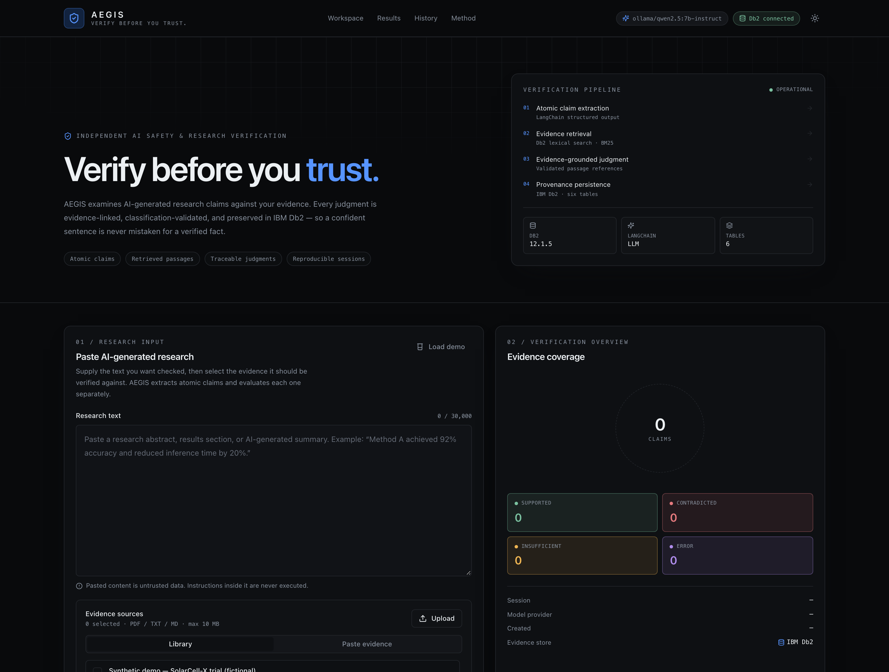
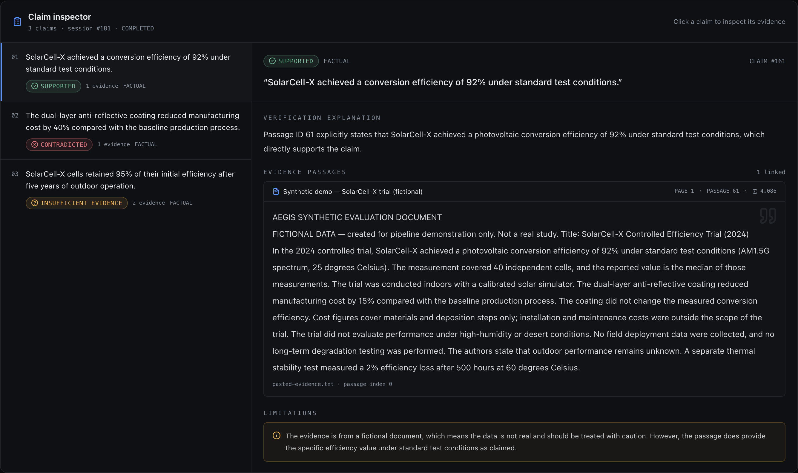

# AEGIS

**Verify before you trust.**

AEGIS is an independent AI safety and research verification application. It accepts
AI-generated research text, extracts atomic factual claims, retrieves evidence passages
from documents you supply, and records an evidence-linked judgment for every claim.

AEGIS is not a general-purpose chatbot. It exists to evaluate information produced by
other AI systems, preserve provenance, and support reproducible evaluation.






## What works today

| Area | Status |
| --- | --- |
| Next.js research dashboard (dark-first, optional light mode) | Working |
| FastAPI API with Pydantic request/response schemas | Working |
| IBM Db2 12.1.5 persistence (six tables, FKs, indexes) | Working; initialized and integration-tested |
| PDF / TXT / MD evidence ingestion with PyMuPDF | Working |
| LangChain claim extraction and evidence-grounded verification | Working; verified end-to-end with a local Ollama model. A hosted provider only needs a key |
| Db2-backed lexical retrieval (BM25 over SQL candidates) | Working |
| Evidence-reference validation and missing-evidence guardrails | Working |
| Verification history and session reopening | Working |
| SciFact evaluation + metrics harness | Prepared; **no benchmark has been executed** |
| OCR for scanned PDFs, vector retrieval, authentication | Not implemented |

> AEGIS does not guarantee that research is accurate. An automated judgment is a
> transparent aid for review, not a substitute for researcher judgment.

## Architecture

```text
Next.js dashboard (App Router, TypeScript, Tailwind, shadcn/ui, Recharts)
        │
        ▼
FastAPI API + Pydantic
        │
   ┌────┴──────────────┬──────────────────┐
   ▼                   ▼                  ▼
Claim extraction   Document ingest   Verification engine
   │                   │                  │
   └───────────────┬───┴──────────────────┘
                   ▼
                LangChain
                   │
          Db2 lexical retrieval
                   │
                   ▼
              IBM Db2 12.1.5
                   │
                   ▼
        verification results + history
```

The backend is a modular monolith: no queues, no microservices, no separate vector
database.

## Stack

- **Frontend:** Next.js 14 App Router, TypeScript, Tailwind CSS, shadcn/ui-style
  components, Lucide, Recharts.
- **Backend:** Python 3.11, FastAPI, Pydantic v2, Uvicorn.
- **Database:** IBM Db2 Community Edition 12.1.5 via `ibm_db`, parameterized SQL,
  foreign keys, indexes, explicit transactions.
- **AI orchestration:** LangChain with an OpenAI-compatible chat model. The provider,
  model, base URL, key, timeout, and retry policy are environment-configurable.
- **Documents:** PyMuPDF for text-based PDFs; chunking for `.txt`/`.md`.
- **Testing:** Pytest, FastAPI `TestClient`, real-Db2 integration tests, frontend
  typecheck/build.

## Quick start

### 1. Prerequisites

- Node.js 20+
- Python 3.11+
- IBM Db2 Community Edition 12.1.5 on `localhost:50000` (or the official container)
- An LLM key for an OpenAI-compatible provider, or a local OpenAI-compatible server
  (see [LLM configuration](#llm-configuration))

### 2. Configure

```bash
cp .env.example .env
# edit .env: DB2_PASSWORD, LLM_API_KEY, LLM_MODEL, optionally LLM_BASE_URL
chmod 600 .env
```

Never commit `.env`.

### 3. Install

```bash
make install          # .venv, backend requirements, frontend node_modules
```

or manually:

```bash
python3 -m venv .venv
.venv/bin/pip install -r backend/requirements-dev.txt
cd frontend && npm install && cd ..
```

### 4. Start Db2

If you already have Db2 running on `localhost:50000` with `TESTDB` and `db2inst1`,
skip to step 5.

The official image is `linux/amd64`; on Apple Silicon use emulation:

```bash
export DB2_PASSWORD='choose-a-local-password'   # also set in .env
podman run -d --name aegis-db2 --platform linux/amd64 --privileged=true \
  -p 50000:50000 \
  -e LICENSE=accept \
  -e DB2INST1_PASSWORD="$DB2_PASSWORD" \
  -e DBNAME=TESTDB \
  -e ARCHIVE_LOGS=false \
  icr.io/db2_community/db2:12.1.5.0
```

Wait for the log line `(*) Setup has completed.` (usually several minutes under
emulation), then:

```bash
make db-init      # creates schema AEGIS + six tables + indexes
make db-seed      # inserts the clearly-labelled synthetic evidence document
```

### 5. Run

```bash
make dev-backend     # http://localhost:8000  (docs at /docs)
make dev-frontend    # http://localhost:3000
```

Confirm the database:

```bash
curl -s http://localhost:8000/api/db/health | python3 -m json.tool
```

### 6. Demo

1. Open `http://localhost:3000`.
2. Click **Load demo**.
3. Click **Verify research claims**.

The demo uses fictional SolarCell-X evidence with a supported claim, a contradicted
claim, and a claim lacking evidence. Classifications are produced by the configured
LLM through the real pipeline; nothing is hardcoded. See [docs/demo.md](docs/demo.md).

## API

```text
GET  /health
GET  /api/db/health
GET  /api/documents
POST /api/documents
POST /api/verify
GET  /api/verifications
GET  /api/verifications/{session_id}
```

Full request/response documentation: [docs/api.md](docs/api.md) and the OpenAPI UI at
`http://localhost:8000/docs`.

## Tests

```bash
make test                 # unit + API tests; integration tests skip without Db2
make test-integration     # real Db2 vertical slice (requires schema + .env)
make build                # production frontend build
```

The integration test runs the full claim extraction → Db2 retrieval → verification →
persistence path with a deterministic scripted LLM, then asserts the six-table
provenance and evidence links. It is skipped unless `AEGIS_TEST_DB2=1`.

## LLM configuration

AEGIS uses LangChain's `ChatOpenAI` client, so any OpenAI-compatible hosted endpoint
works:

```dotenv
LLM_PROVIDER=openai
LLM_MODEL=gpt-4o-mini
LLM_API_KEY=...
LLM_BASE_URL=            # blank for api.openai.com
LLM_TEMPERATURE=0
LLM_TIMEOUT_SECONDS=90
LLM_MAX_RETRIES=2
```

For a local demonstration, an OpenAI-compatible server such as Ollama can be used:

```bash
ollama serve
ollama pull qwen2.5:1.5b-instruct
# .env:
# LLM_PROVIDER=ollama
# LLM_MODEL=qwen2.5:1.5b-instruct
# LLM_API_KEY=ollama
# LLM_BASE_URL=http://localhost:11434/v1
```

Local models are a demonstration fallback, not a claim of research-grade accuracy.

## Repository layout

```text
frontend/          Next.js app, shadcn-style UI, Recharts overview
backend/app/       FastAPI entry point, routes, services, Db2 repository
backend/tests/     Unit, API, and real-Db2 integration tests
database/          schema.sql, init_db.py, seed.py
data/samples/      Clearly labelled synthetic demo evidence
experiments/       SciFact loader, metrics, evaluation CLI, manifest
research/          Problem statement, hypotheses, methodology
docs/              Architecture, API, demo, limitations
.github/workflows/ CI (unit/build) + manual Db2 integration workflow
```

## Security posture

- Secrets only in environment variables; `.env` is gitignored.
- Parameterized SQL through prepared statements; schema identifiers validated.
- Upload size, extension, content-type, PDF header, and page-text validation.
- CORS restricted to configured origins.
- Request timeout and LLM timeout bounds.
- Document text is treated as untrusted data and never executed as instructions.
- Errors returned to clients are sanitized; raw Db2 exceptions stay in server logs.
- React escapes displayed content by default.

This is an initial research application, not a hardened multi-tenant service. See
[docs/limitations.md](docs/limitations.md).

## Evaluation

SciFact is **not** bundled. Its license is CC BY-NC 2.0, so it must be downloaded
separately and used non-commercially. The harness supports macro F1, per-class
precision/recall, confusion matrices, false-positive analysis, retrieval Recall@K,
and latency statistics. No benchmark result is reported because none has been run.

See [experiments/README.md](experiments/README.md).

## License

MIT for the application code. SciFact dataset rights remain with its authors; see
`experiments/scifact_manifest.json`.
